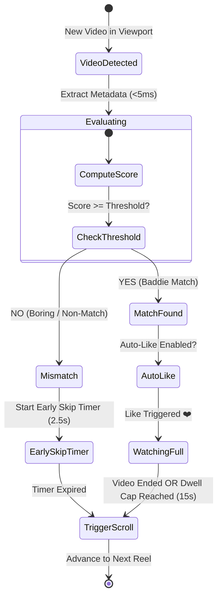

# 🧠 Doomscroll Co-Pilot: Wackathon Project Plan & Specification

> An automated, zero-latency short-form video consumer, evaluator, and engagement agent built with **WXT**, **React**, and **TypeScript** for **TikTok**, **Instagram Reels**, and **YouTube Shorts**.

---

## 1. Executive Summary & Wackathon Vision

### 1.1 The Concept
Social media platforms are engineered to trap human thumbs in infinite dopamine loops. **Doomscroll Co-Pilot** satirizes and solves this dilemma by turning doomscrolling into an automated, hands-free utility. 

It autonomously scrolls through short-form video feeds, inspects each clip's metadata and tags in milliseconds, and executes simulated engagement actions:
- **Auto-Liking**: Specifically triggers when content matches the **Baddie Target** criteria above a user-defined confidence threshold.
- **Content-Aware Auto-Scrolling**: Implements a high-efficiency **Scroll Cadence**—watching full clips (up to a **Dwell Cap**) when matched, but executing an **Early Skip** within 2–3 seconds on non-matching or boring videos to optimize dopamine intake.
- **Zero API Friction**: Operates 100% locally in-browser via DOM metadata inspection (avoiding CORS canvas corruption, external API keys, latency, or rate limits).

### 1.2 Target Platforms
- **TikTok Web** (`https://www.tiktok.com/*`, `/foryou`)
- **Instagram Reels** (`https://www.instagram.com/reels/*`)
- **YouTube Shorts** (`https://www.youtube.com/shorts/*`)

---

## 2. Technology Stack & Directory Architecture

### 2.1 Core Tooling
- **Framework**: [WXT](https://wxt.dev/) (Next-Gen Web Extension Framework) targeting Manifest V3.
- **UI Runtime**: React 18 / 19 + TypeScript.
- **Package Manager**: `pnpm`.
- **State & Storage**: `chrome.storage.local` with WXT storage API bindings.
- **Styling**: Modern dark-mode vanilla CSS with neon accents, custom sliders, and micro-animations.

### 2.2 Project Structure
```text
wackathon/
├── CONTEXT.md                               # Domain vocabulary & ubiquitous language
├── docs/
│   └── adr/                                 # Architectural Decision Records
│       ├── 0001-browser-extension-architecture.md
│       ├── 0002-popup-only-ui-architecture.md
│       ├── 0003-client-side-metadata-evaluation.md
│       └── 0004-wxt-framework-react-typescript.md
├── package.json
├── pnpm-lock.yaml
├── tsconfig.json
├── wxt.config.ts                            # WXT manifest & build configuration
├── entrypoints/
│   ├── background.ts                        # Background service worker (badge text, state relay)
│   ├── content.ts                           # Content script loader (routes to active platform adapter)
│   └── popup/                               # Brainrot Dashboard extension popup
│       ├── index.html
│       ├── main.tsx
│       ├── App.tsx
│       ├── App.css
│       └── components/
│           ├── MasterSwitch.tsx             # Global On/Off toggle
│           ├── TargetControl.tsx            # Auto-Like Baddies toggle & Confidence Slider
│           ├── TelemetryCard.tsx            # Current clip, platform, tags, match score
│           ├── KeywordEditor.tsx            # Tag dictionary manager
│           └── MetricsDisplay.tsx           # Humorous stats (Braincells Lost, Dopamine Saved)
└── src/
    ├── types/
    │   ├── state.ts                         # Extension global state & settings schema
    │   └── platform.ts                      # Platform adapter interface
    ├── engine/
    │   ├── evaluator.ts                     # Weighted hashtag & caption scoring engine
    │   ├── cadence.ts                       # Watch timer & early skip state machine
    └── defaultKeywords.ts                   # Default weighted tag dictionary
    └── platforms/
        ├── adapter.ts                       # Base PlatformAdapter interface
        ├── tiktok.ts                        # TikTok DOM selectors & interaction drivers
        ├── instagram.ts                     # Instagram Reels DOM selectors & drivers
        └── youtube.ts                       # YouTube Shorts DOM selectors & drivers
```

---

## 3. Core Subsystems & Mechanics

### 3.1 Platform Adapters (`src/platforms/`)
Each platform implements a standardized `PlatformAdapter` interface:

```typescript
export interface VideoMetadata {
  caption: string;
  hashtags: string[];
  creatorHandle: string;
  soundTitle: string;
}

export interface PlatformAdapter {
  platformId: 'tiktok' | 'instagram' | 'youtube';
  isMatch(url: string): boolean;
  getActiveVideoElement(): HTMLVideoElement | null;
  extractMetadata(): VideoMetadata;
  isLiked(): boolean;
  clickLike(): Promise<boolean>;
  scrollNext(): Promise<void>;
}
```

#### Platform Selector Map
| Platform | Active Container Selector | Video Element | Like Button Selector | Metadata / Tag Source | Scroll Action |
| :--- | :--- | :--- | :--- | :--- | :--- |
| **TikTok** | `[data-e2e="recommend-list-item-container"]` or current viewport item | `video` | `[data-e2e="like-icon"]`, `[data-e2e="browse-like-icon"]` | `[data-e2e="browse-video-desc"]`, `h1[data-e2e="video-desc"]` | Keyboard `ArrowDown` / synthetic wheel |
| **Instagram Reels** | `article`, `div[role="dialog"]`, or active viewport reel | `video` | `svg[aria-label="Like"]` (checks for filled vs outline) | Caption `span`, `h1`, hashtag links `a[href*="/explore/tags/"]` | Keyboard `ArrowDown` / container scroll |
| **YouTube Shorts** | `ytd-reel-video-renderer[is-active]` | `video` | `ytd-like-button-renderer #like-button button` | `#title.ytd-reel-player-header-renderer`, `#description` | Keyboard `ArrowDown` / `j` key |

---

### 3.2 The Evaluator Engine (`src/engine/evaluator.ts`)
The Evaluator determines whether the current reel matches the **Baddie Target** by computing a normalized confidence score ($0.0 \le S \le 1.0$).

#### Scoring Algorithm
1. **Hashtag Normalization**: Convert all extracted tags to lowercase, stripping `#` and punctuation.
2. **Weighted Dictionary Match**:
   - **Tier 1 (Core Baddie Indicators - Weight: 0.45 each)**:
     `baddie`, `fitcheck`, `ootd`, `grwm`, `slay`, `model`, `baddest`, `glam`
   - **Tier 2 (Aesthetic & Vibe Indicators - Weight: 0.25 each)**:
     `aesthetic`, `glowup`, `makeup`, `gymgirl`, `hotgirl`, `fashion`, `cleangirl`
   - **Tier 3 (Contextual Keywords in Captions - Weight: 0.15 each)**:
     `outfit`, `dress`, `hair`, `nails`, `transformation`, `pretty`
   - **Negative / Disqualifying Tags (Weight: -0.50)**:
     `gaming`, `minecraft`, `subwaysurfers`, `gta`, `podcast`, `coding`, `news`
3. **Score Clamping**:
   $$\text{Confidence Score} = \min\left(1.0, \max\left(0.0, \sum \text{Weights}\right)\right)$$
4. **Decision Boundary**:
   If `Auto-Like Baddies` is enabled AND $\text{Confidence Score} \ge \text{User Threshold}$, trigger **Like**.

---

### 3.3 The Content-Aware Cadence State Machine (`src/engine/cadence.ts`)



- **Early Skip Timing**: $2.5\text{ seconds} \pm 0.5\text{s}$ jitter (allows enough time for the viewer to glimpse the video before automatically discarding it).
- **Match Watch Duration**: Plays until video `timeupdate` reaches `duration - 0.5s`, or caps at the **Dwell Cap** ($15\text{s}$ default, configurable $5\text{s}$–$30\text{s}$) to avoid stalling on looped audio.

---

### 3.4 Brainrot Dashboard UI (`entrypoints/popup/`)
The extension popup serves as the command center:

1. **Header**: Glowing status pill (`ACTIVE` / `STANDBY`) + Platform badge (`TikTok`, `Instagram`, or `YouTube`).
2. **Master Controls**:
   - Master Auto-Pilot Toggle (`ON` / `OFF`).
   - "Auto-Like Baddies" Master Switch (`ON` / `OFF`).
   - "Confidence Threshold" Slider ($0\%$ to $100\%$, default $50\%$).
   - "Dwell Cap" Slider ($5\text{s}$ to $30\text{s}$).
3. **Live Telemetry Card**:
   - Creator handle & detected audio title.
   - Identified hashtags (rendered as highlight chips).
   - Real-time Match Score bar (e.g. `Score: 82% [BADDIE CONFIRMED]`).
   - Current Action state (`Liked ❤️`, `Watching (8s/15s)`, or `Early Skipping in 1.4s ⏩`).
4. **Keyword Bank Editor**:
   - Interactive tag manager permitting users to add or remove custom hashtags.
5. **Brainrot Metrics**:
   - 📺 **Videos Scrolled**: Count of total clips traversed.
   - 💖 **Baddies Liked**: Count of auto-liked clips.
   - 🧠 **Braincells Lost**: Humorous derived metric ($\text{Videos Scrolled} \times 1.5$).
   - ⚡ **Dopamine Optimized**: Humorous percentage score based on early skips.

---

## 4. Inter-Process Communication (IPC) Protocol

Communication between the isolated **Content Script** and the **Popup / Background**:

```typescript
export type ExtensionMessage =
  | { type: 'STATE_CHANGED'; payload: Partial<AutoPilotSettings> }
  | { type: 'CLIP_ANALYZED'; payload: ClipTelemetry }
  | { type: 'METRICS_INCREMENT'; payload: { scrolled?: number; liked?: number } }
  | { type: 'GET_CURRENT_STATUS' };

export interface ClipTelemetry {
  platform: 'tiktok' | 'instagram' | 'youtube' | 'unsupported';
  creator: string;
  hashtags: string[];
  score: number;
  isMatch: boolean;
  actionTaken: 'liked' | 'skipped' | 'watching' | 'idle';
}
```

- State is persisted via `chrome.storage.local`.
- When settings change in the Popup, a broadcast message notifies the active tab content script.
- The content script continuously syncs real-time telemetry back into storage for popup rendering.

---

## 5. Step-by-Step Implementation Roadmap

### Phase 1: Environment & Project Scaffolding
- Initialize WXT template with React + TypeScript using `pnpm`:
  ```bash
  pnpm dlx create-wxt@latest . --template react
  ```
- Configure `wxt.config.ts` with host permissions:
  - `*://*.tiktok.com/*`
  - `*://*.instagram.com/*`
  - `*://*.youtube.com/*`
  - Storage & scripting permissions.

### Phase 2: Domain Logic & Evaluation Engine
- Implement `src/engine/defaultKeywords.ts` with weighted tag tables.
- Implement `src/engine/evaluator.ts` scoring functions and unit tests.
- Implement `src/types/state.ts` defining default settings and metrics.

### Phase 3: Platform Adapters & DOM Drivers
- Implement `src/platforms/adapter.ts`.
- Implement `src/platforms/tiktok.ts`:
  - Test selectors for current video item, like button, caption text.
  - Test synthetic `KeyboardEvent('keydown', { key: 'ArrowDown', code: 'ArrowDown' })`.
- Implement `src/platforms/instagram.ts`:
  - Target Reels viewport containers and like SVGs.
- Implement `src/platforms/youtube.ts`:
  - Target `ytd-reel-video-renderer[is-active]`.

### Phase 4: Cadence State Machine & Content Script Integration
- Wire up video time listeners (`ended`, `timeupdate`) and mutation observers.
- Integrate early-skip timeouts ($2.5\text{s}$) when score falls below threshold.
- Integrate simulated like-button click when matched.

### Phase 5: Popup Dashboard UI (React)
- Create dark-mode cyberpunk aesthetic popup with custom toggle switches and sliders.
- Build `TelemetryCard` displaying current video analysis in real time.
- Build `KeywordEditor` for custom user tag additions.
- Connect reactive hooks to `chrome.storage.local`.

---

## 6. Wackathon Demo Presentation Script

1. **The Pitch (30s)**:
   > "Judges, the average person wastes 3 hours a day manually scrolling and filtering short-form brainrot. Why suffer through boring videos or tire your thumb liking content? We present **Doomscroll Co-Pilot**: the world's first AI-less, autonomous short-form dopamine accelerator."
2. **The Live Demo (60s)**:
   - Open TikTok / Instagram Reels in Chrome.
   - Open extension popup: turn **Auto-Pilot ON**, toggle **Auto-Like Baddies ON** with a $60\%$ threshold.
   - Show a random cooking or gaming video appear: within $2.5\text{s}$, the system flags it as non-matching ($10\%$ score) and **automatically skips it**.
   - A fit-check/OOTD clip appears: within $5\text{ms}$, the system detects `#fitcheck #ootd #slay` ($88\%$ score), **instantly likes the video ❤️**, and allows it to play full-length.
   - Open popup: showcase the live **Brainrot Metrics** ("42 Videos Scrolled, 9 Baddies Liked, 63 Braincells Lost, 94% Dopamine Efficiency").
3. **The Punchline**:
   > "Zero API keys. Zero latency. 100% automated brainrot."
